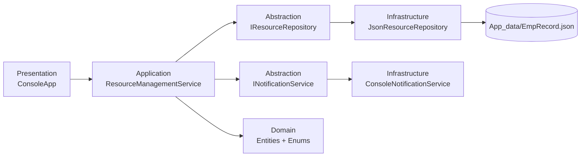
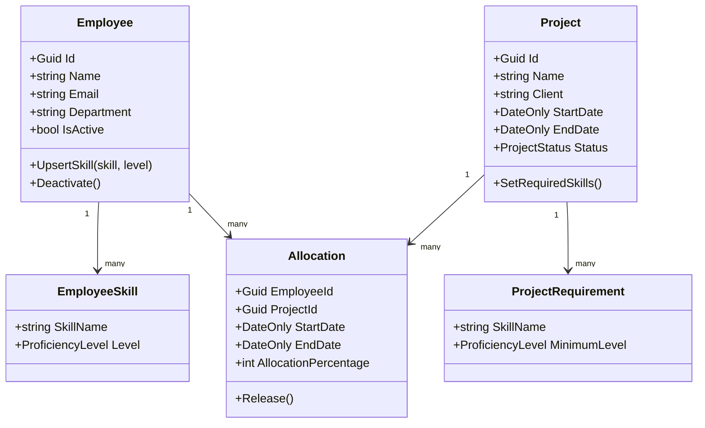

# Design Document

## Architecture diagram

## Domain/class diagram

## Architecture Decision Records (ADRs)

### ADR-001: Layered modular architecture
- Context: Need future extension to MVC, EF Core, and .NET MAUI without rewriting business logic.
- Decision: Separate `Domain`, `Application`, `Infrastructure`, and `Presentation` concerns.
- Alternatives considered: Single-project monolith with mixed concerns.
- Consequences: Better maintainability/testability; slightly more files and setup.

### ADR-002: JSON file persistence behind repository abstraction
- Context: Persistence required without database.
- Decision: Use `IResourceRepository` and `JsonResourceRepository` with `ResourceDataStore`.
- Alternatives considered: Direct file access inside service methods.
- Consequences: Swappable persistence implementation; easier tests.

### ADR-003: Service-centered business rules
- Context: Allocation rules must be consistently enforced.
- Decision: Put orchestration/business rule checks in `ResourceManagementService`.
- Alternatives considered: Put all checks in console UI.
- Consequences: Rules are reusable and UI-agnostic.

### ADR-004: Console notification abstraction
- Context: Notification needed today as simulation, but may evolve later.
- Decision: Introduce `INotificationService` with console implementation.
- Alternatives considered: `Console.WriteLine` directly in service.
- Consequences: Enables replacement with email/queue implementation without touching core logic.

### ADR-005: In-memory test doubles for application tests
- Context: Need broad rule testing without file I/O dependency.
- Decision: Test via in-memory repository/notifier doubles.
- Alternatives considered: Integration tests against real JSON file only.
- Consequences: Fast deterministic tests; separate integration tests can be added later.

## SOLID mapping
- S (Single Responsibility):
  - `JsonResourceRepository` handles persistence only.
  - `ConsoleNotificationService` handles notifications only.
  - `ConsoleApp` handles UI flow only.
- O (Open/Closed):
  - Add new notification or persistence implementation via interfaces without changing service consumers.
- L (Liskov Substitution):
  - `IResourceRepository` and `INotificationService` implementations are replaceable in tests/production.
- I (Interface Segregation):
  - Focused contracts for repository and notification abstractions.
- D (Dependency Inversion):
  - `ResourceManagementService` depends on abstractions, not concrete infrastructure.

### Deliberate non-application of a SOLID principle
- We chose a single `IResourceManagementService` façade instead of many tiny service interfaces.
- Why: For this assignment, a single orchestration surface keeps console integration simple and reduces unnecessary complexity.
- Tradeoff: Interface is broader than a strict ISP interpretation, but acceptable for current scope.
